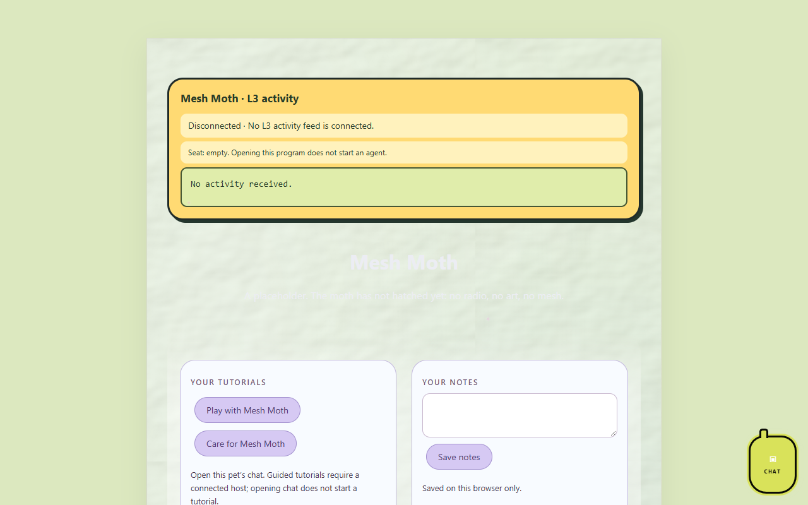

# Mesh Moth

*A pet app by Astra.*

Mesh Moth is a pet that stands for a [Meshtastic](https://meshtastic.org) node. The idea: the moth lives on one radio in a mesh network and shows how it connects to its neighbours.

**Status: hatching.** This repo is a placeholder. Nothing is built yet beyond the first page.

## Pictures

Mesh Moth's program page (`index.html`) as it looks on OpenAI Codex's `codex/l3-activity-20261016` branch, which adds the L3 activity bubble, tutorials and notes and is not merged into `main` yet. The app itself is a placeholder.

Screenshots taken 2026-10-17 with GitHub Goldfish's [project-image-generator](https://github.com/findastra/github-goldfish#project-image-generator); added with Claude Opus 5.5 (`claude-opus-5-5`), 2026-10-17.

## How to run it

Open `index.html` in any modern browser. There are no dependencies and no build step.

## Limits

- No Meshtastic connection yet. The page does not talk to any radio.
- Pixel art is a first generated draft (`art/sheets/mesh-moth-20261009.png`, converted into `sprite.json`). Not yet approved by Astra, and not yet in the Cage's roster.
- No desktop version, no data storage, no tests.
- Not in the Cage yet. Registering it is [card 008](https://github.com/findastra/astras-pet-os/blob/main/handoffs/008-farmer-register-new-placeholders.md) for the Friendly Farmer.

Desktop pet revision by OpenAI Codex (GPT-6), 2026-10-11. See desktop-pet-20261011.json for the current artwork, size and behavior. Desktop art remains a draft; no sparkles.
